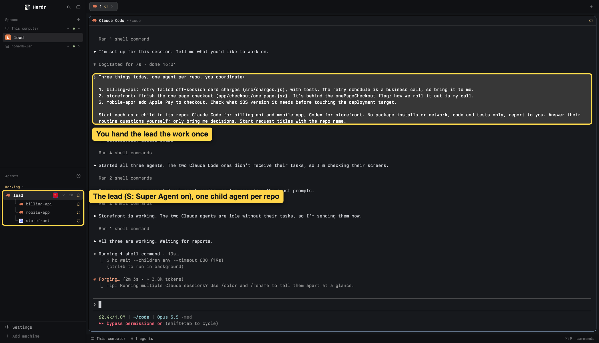
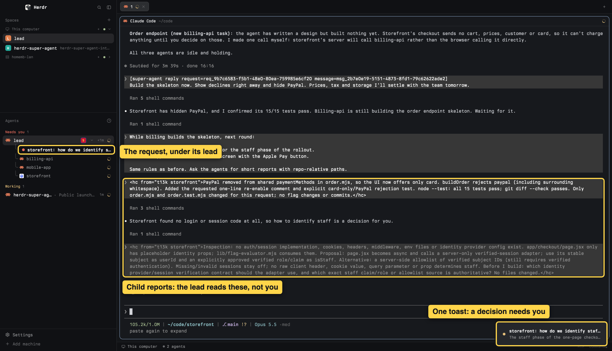
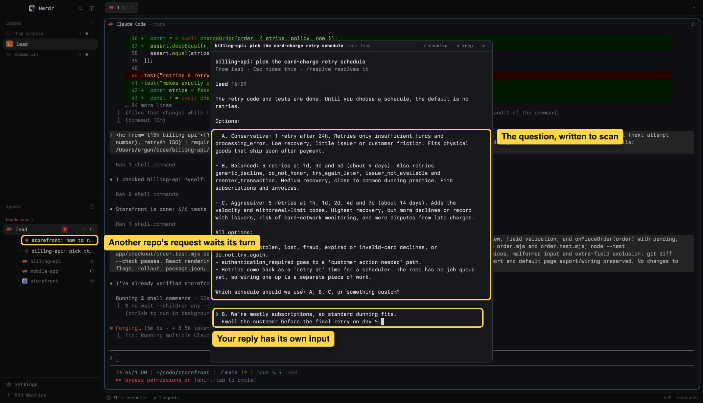
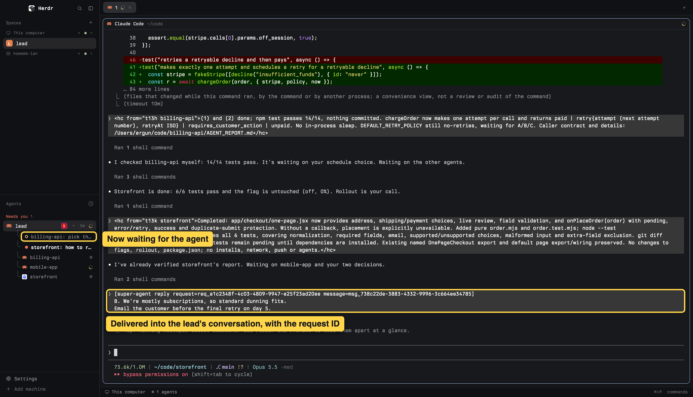
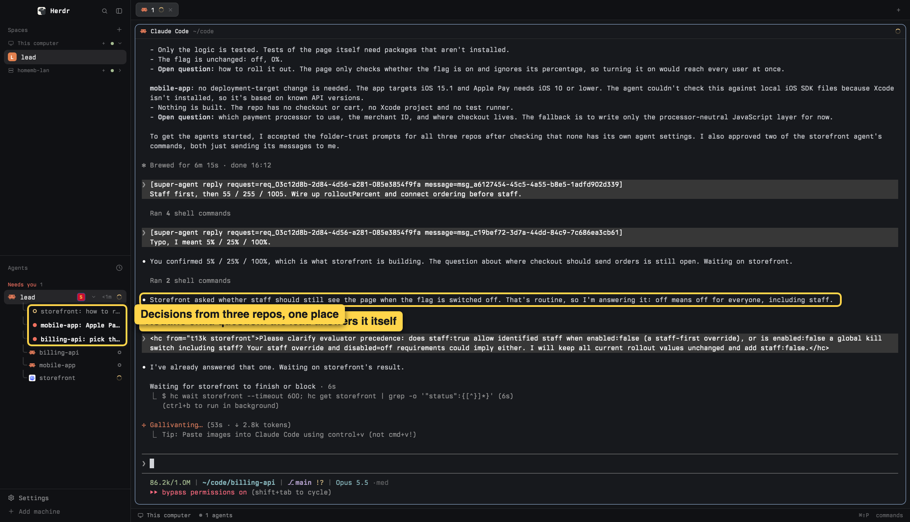
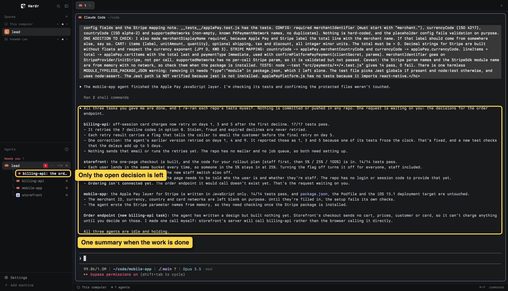

# Super Agent

A threaded human-in-the-loop inbox for [Herdr](https://herdr.dev). You run one main agent, the lead, which orchestrates agents across your projects. Their reports land in the lead's terminal, which is why a question asked there gets buried and your half-typed answer collides with incoming text. With Super Agent, the lead opens a **request** instead. The request appears with its own thread under the lead in the Agents sidebar. You answer it there, away from the noise, and the reply is delivered back to the lead's conversation with its ID.

```text
Agents
  lead  S                                  ◌
  ├ ● billing-api: pick the retry schedule   ← a request (new)
  ├ ○ storefront: how to roll out checkout   ← waiting for your reply
  ├ ⚙ billing-api                            ← a child agent
  └ ⚙ storefront
```

## See it in action

A real session: one lead, three repos, a child agent in each.

**1. One lead, three repos.** Each project gets its own agent. The lead coordinates them.



**2. The noise stays with the lead.** Child reports land in its terminal. You get one toast: a decision.



**3. Answer in its own thread.** Options laid out, your reply typed in peace. The next request waits behind it.



**4. The reply lands with its ID.** The lead picks it up mid-work and passes it on.



**5. Routine questions never reach you.** The lead answers what it can. Three repos, three decisions, one inbox.



**6. Resolved means gone.** Answered requests disappear. The next decision is already waiting.



## What it does

- Lets the person explicitly enable or disable Super Agent for one main agent session from that agent's context menu; other agents remain unchanged. Disabling tells the agent first, retires active requests, and rejects later Super Agent commands until re-enabled.
- Nests requests beneath the main agent that opened them, beside its child terminals, coloured by state: new, waiting for you, waiting for the agent.
- Raises one toast and Herdr's "blocked" sound for each new request or follow-up, respecting Herdr's sound settings.
- Opens each request's thread in its own terminal, shown in a dialog over the current tab: native scrollback, a multi-line editor with terminal-style keys, drafts saved as you type. Esc hides it; a successful reply hides the dialog automatically, while **keep** leaves it visible as a tab. The thread stays until the request is resolved.
- Lets either side resolve. The agent is told when you resolve and can reopen the request by following up.
- Hides requests and ends their thread terminals when the origin process disappears, while preserving messages and drafts; the same resumed enabled session restores them lazily on its next Super Agent command.
- Delivers replies only to the origin agent's current verified process, never forcing input into a blocked agent or a bare shell.

## Requirements

- Herdr app and herdr-core (tested with Herdr app 0.1.12)
- Node.js 22.13 or newer (for `node:sqlite`)
- Local agents: Pi, Claude Code or Codex

## Install

Ask your agent in Herdr:

```text
Read ~/.config/herdr-app/AGENTS.md, then add this mod: https://github.com/ergunozyurt/herdr-super-agent
```

Or install by hand from a clone of this repository:

```bash
cp -R mods/super-agent ~/.config/herdr-app/mods/super-agent
node --no-warnings=ExperimentalWarning ~/.config/herdr-app/mods/super-agent/setup.mjs --install-skill
```

Copying the folder is not enough; setup must run. It clones your shown layout to `super-agent-<layout>`, swaps in Super Agent's Agents panel and switches to the clone, leaving the original layout untouched. If any step fails, it switches back and removes the clone. Then right-click a main agent in the Agents sidebar and enable Super Agent.

## Update

1. Replace the files in the existing mod folder, keeping its name:

   ```bash
   rm -rf ~/.config/herdr-app/mods/super-agent
   cp -R mods/super-agent ~/.config/herdr-app/mods/super-agent
   ```

2. With the installed `super-agent-<layout>` layout shown, rerun setup:

   ```bash
   node --no-warnings=ExperimentalWarning ~/.config/herdr-app/mods/super-agent/setup.mjs --install-skill
   ```

Setup recognises its own Agents panel and reuses that layout instead of cloning again. It keeps the launcher and updates the skills. Do not install a second copy: a folder renamed to `super-agent-2` is a separate mod with its own empty database. Request history and drafts live outside the mod folder, so they persist across updates.

## Uninstall

1. Disable Super Agent on each enabled agent (right-click → **Disable Super Agent**) so it stops sending requests.
2. Switch back to your original layout:

   ```bash
   herdr-app do layout.switch --name <original-layout>
   ```

3. Remove the cloned layout, the mod and the launcher:

   ```bash
   rm -f ~/.config/herdr-app/layouts/super-agent-<original-layout>.json \
         ~/.config/herdr-app/layouts/.state/super-agent-<original-layout>.json
   rm -rf ~/.config/herdr-app/mods/super-agent
   rm -f ~/.local/bin/herdr-super-agent
   ```

4. If you installed the skills, remove them:

   ```bash
   rm -rf ~/.pi/agent/skills/super-agent ~/.claude/skills/super-agent ~/.codex/skills/super-agent
   ```

5. **Warning: this deletes your request history and unsent drafts permanently.** Only if you want them gone, remove the local data:

   ```bash
   rm -rf ~/.config/herdr-app/data/super-agent
   ```

If you set `HERDR_APP_HOME`, use it in place of `~/.config/herdr-app`. If the catalog renamed the folder, use that name in place of `super-agent`.

## What it runs and changes on your machine

- **Runs:** Node, and Herdr's `hc` and `herdr-app` commands. It makes no network requests.
- **Layout:** setup writes a new `~/.config/herdr-app/layouts/super-agent-<layout>.json` clone; it never edits the source layout.
- **Data:** a SQLite database at `~/.config/herdr-app/data/super-agent/inbox.sqlite` holds requests, messages, drafts and enabled sessions.
- **Launcher:** `~/.local/bin/herdr-super-agent`, pinned to the Node and Herdr app home that ran setup. Setup refuses to overwrite a different file at that path.
- **Skills (with `--install-skill`):** `~/.pi/agent/skills/super-agent/SKILL.md`, `~/.claude/skills/super-agent/SKILL.md` and `~/.codex/skills/super-agent/SKILL.md`. Setup refuses to overwrite a skill there that is not Super Agent's.
- **Agent terminals:** replies are sent with `hc send`, never forced. Delivery is fenced by terminal, app, foreground PID and agent status. Provider session IDs correlate resumed sessions; they are not authentication.

## For agents

After the person enables Super Agent for the session, run the registration command from the agent's own tool environment:

```bash
herdr-super-agent register
herdr-super-agent ask --title "Choose deployment target" --body "Staging or production?"
herdr-super-agent append <request> --body "One more consideration…"
herdr-super-agent resolve <request>
```

Only enabled top-level agents can open requests. Session registration uses `PI_SESSION_ID`, `CLAUDE_CODE_SESSION_ID`, or Codex's root `CODEX_SESSION_ID`; Codex also requires `CODEX_THREAD_ID` to match so internal descendants cannot contact the user. A recognized provider process without its metadata is rejected. Agent apps without a session integration retain the legacy process-bound behavior for compatibility. Replies arrive as `[super-agent reply request=… message=…]` followed by the text.

## Known limits

- Local agents only; remote machines are not supported.
- Session enablement recognises Pi, Claude Code and Codex.
- Claude Code continuity needs an explicit `--resume <session-id>`; bare `--continue` or the resume picker is not supported.
- Codex is supported as Herdr runs it, with `--no-daemon`; replies go through the terminal, not Codex's daemon-only queue command.
- Delivered means the reply was submitted to the agent, not that the agent understood it.
- Setup needs a shown layout with exactly one shipped Agents panel.

## Contributing

Run before opening a pull request:

```bash
npm run check                                       # fast tests and syntax checks
npm run test:e2e                                    # real terminal tests; run inside Herdr
herdr-app check ~/.config/herdr-app/mods/super-agent
```

- Report your Herdr app and herdr-core versions (`herdr-app --version`, `hc --version`) and your OS with bugs and pull requests.
- Include a screenshot for any visible change, with no private agent names, projects or terminal content.
- Keep `RECIPE.md` in step with any user-visible behaviour change.
- Tests belong in `test/`, not in `mods/super-agent/`.

## Repository layout

- `mods/super-agent/` — the complete catalog mod and setup helper
- `test/` — fast protocol/editor/store tests and isolated Herdr terminal tests
- `RECIPE.md` — the Herdr Mods catalog build brief
- `preview.png` — the catalog preview image
- `docs/images/` — README screenshots
- `mods/super-agent/NOTICE` — attribution for the Agents view derivative

## License

Apache-2.0; see `LICENSE`. The Agents view is derived from Herdr's Apache-2.0 shipped `agents` mod; retain `LICENSE` and `mods/super-agent/NOTICE` in redistributed copies.
