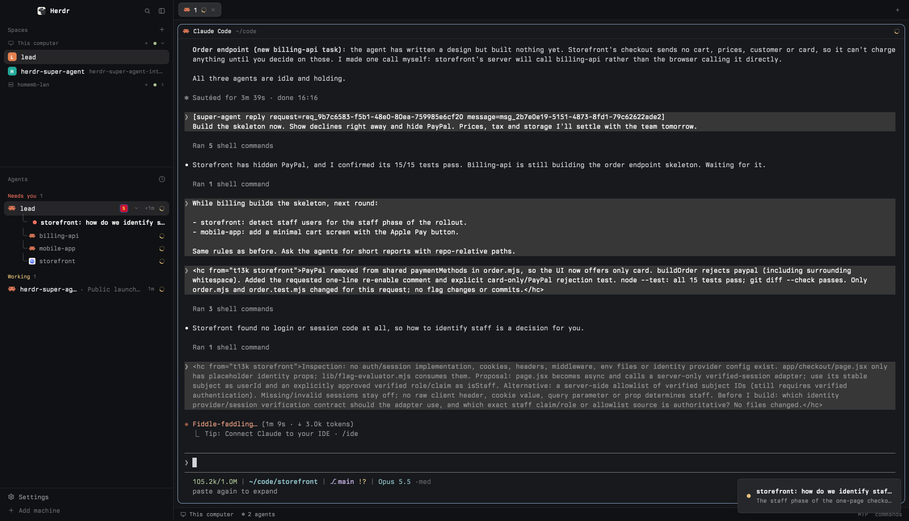

# Super Agent

Your main agent stops asking questions in its busy terminal. It opens a request instead: a row under it in the Agents sidebar, with its own thread you answer in a dialog. Child agents report to the main agent; only decisions reach you.



**Before you add it.** Copying `mods/super-agent/` is incomplete until setup runs. Setup runs Node and `herdr-app`; the mod runs Node and Herdr's `hc`; neither makes network requests. Paths assume the default app home `~/.config/herdr-app` (`HERDR_APP_HOME` overrides it) and the folder name `super-agent` (use the installed name if renamed). Setup writes outside the mod folder:

- `~/.config/herdr-app/layouts/super-agent-<shown layout>.json` (or `-2`, `-3`, …): a clone of the shown layout with this mod's Agents block; setup switches to it and leaves the source layout unchanged.
- `~/.config/herdr-app/data/super-agent/inbox.sqlite` (plus `-wal`, `-shm` and `inbox.sqlite.revision`): requests, threads and drafts.
- `~/.local/bin/herdr-super-agent`: a launcher pinned to the current Node, mod folder and app home.
- With `--install-skill`, the same communication-policy skill at `~/.pi/agent/skills/super-agent/SKILL.md`, `~/.claude/skills/super-agent/SKILL.md` and `~/.codex/skills/super-agent/SKILL.md`.

**Stop here and ask the person.** List these effects, then ask whether to run setup, and wait for a yes. Telling them is not enough: do not run setup until they agree:

```bash
node --no-warnings=ExperimentalWarning ~/.config/herdr-app/mods/super-agent/setup.mjs --install-skill
```

**Updating.** If Super Agent is already installed, this is an update, not a name clash: replace the files in the existing installed folder rather than adding a second copy such as `super-agent-2` (a renamed copy gets its own empty data directory and its own clone). Then show the installed Super Agent layout and rerun setup; it reuses that layout instead of cloning again. Rerun from any other layout and it makes another clone. The SQLite database is never reset, so requests, threads and drafts persist.

## What you see

The existing Herdr layout stays intact except for its Agents panel. Right-clicking a live main agent shows one compact branded action rather than a redundant agent-name header: a gold `S` on deep red and the current Super Agent action/state. Enabling asks for confirmation; the row shows `…` until registration and the same `S` badge once enabled. Right-clicking an enabled row offers `Disable Super Agent`; after confirmation the agent receives a stop notice, its active requests retire and hide, and the badge disappears. Request rows appear beneath each top-level agent before its child terminals, with a thin separator when both exist. A row has a small state mark, a truncated title, and `New`, `Needs reply`, or `Waiting` at the right.

Selecting a request shows its thread terminal in a dialog under a peek-style header: the request title, "from <agent>" (named as the sidebar names it), ✓ resolve, ↗ keep (make it a tab) and ✕ (hide). The thread prints the title, then each message once into the terminal's own scrollback, with a multi-line reply editor pinned below: Enter sends, Shift+Enter adds a line, Up/Down move between lines, and the usual Ctrl/Alt editing chords work. Esc, ✕ or a click beside the dialog hides it; a successfully delivered reply also hides the dialog automatically. **↗ keep** is the explicit choice to leave it visible as a tab. Selecting the request again returns to the same terminal and draft. Messages have breathing room after their author line, preserve explicit paragraphs and blank lines, wrap at word boundaries, and reprint when the width changes.

## How it behaves

The person enables Super Agent for one live main agent from its context menu. Super Agent sends the agent a condensed communication policy and the agent runs `herdr-super-agent register` from its own tool environment. A recognized Pi, Claude Code or Codex session that has not been enabled, has been disabled, lacks its session metadata, or is an internal Codex descendant cannot use Super Agent commands. Disabling takes effect only after the stop notice reaches the agent.

An enabled main agent creates a request with `herdr-super-agent ask`. Before emitting any person-directed question—including side questions, carry-over items, approvals, confirmations and sign-offs—it opens the request first. It does not duplicate the question in its terminal or narrate that it opened, copied, moved or posted something to Super Agent. New and follow-up requests are unread, raise one Herdr toast, and play the standard blocked sound; a thread on screen gets no toast. Showing a thread marks it read. A submitted reply changes it to waiting for the agent. An agent follow-up returns it to unread. Sending `/resolve`, or the header's ✓ resolve, resolves it at once once the agent has been told; the agent can reopen it with a follow-up, and a failed delivery leaves it open. Request rows show state by color: a filled "needs you" dot for a new message, a "needs you" ring once read, a "working" ring while the agent has the turn. When either side resolves the request its thread terminal ends, the dialog closes, and the row disappears.

Replies go only to the origin agent. An idle, working or done agent receives them; a blocked agent or a plain shell is refused. A delivered reply clears the draft and hides a dialog-hosted thread; a kept tab stays visible. A failed or timed-out delivery keeps the draft and the dialog open.

Drafts are saved as you type and survive hiding, reopening, incoming messages, a restarted thread terminal and loss of the origin process. After the liveness grace, an unavailable origin's rows and dialog disappear and its thread terminals end; the same resumed enabled session gets its requests back when it next registers, asks, follows up or resolves.

## Built from

The repository contains one catalog mod folder, `mods/super-agent/`, and no `layouts/` directory. `main.js` dispatches two prop roles:

- `agents-view.js`: an Apache-2.0 derivative of Herdr's shipped Agents mod, extended with request rows, notification ownership, thread terminal start/show/hide, and conservative origin pruning.
- `lib/thread.mjs` (run as `super-agent.mjs thread <request>`): the terminal thread. It reads and writes SQLite in-process, prints messages into scrollback, and pins `lib/editor.mjs` below them; `lib/keys.mjs` decodes legacy, CSI, Kitty CSI-u and bracketed-paste input. `lib/delivery.mjs` is shared with the CLI.

`inbox-client.js` is the mod-side adapter to `bin/super-agent.mjs`. `lib/identity.mjs` maps reported agent apps to provider session metadata: Pi uses `PI_SESSION_ID`, Claude Code `CLAUDE_CODE_SESSION_ID`, and Codex root `CODEX_SESSION_ID` with matching `CODEX_THREAD_ID`; agent apps without an identity integration keep a process-bound compatibility path. The Node helper uses built-in `node:sqlite` with WAL, busy timeout, immediate write transactions, causal revisions, expected-revision fencing, delivery reservations, enabled sessions, current process bindings, pending enablements, and hidden resolved tombstones.

Committed mutations atomically replace `inbox.sqlite.revision`. The mods wait only for that logical signal and ignore SQLite's `-wal`/`-shm` churn, preventing refresh loops.

Delivery records a pending operation, revalidates terminal state, app and foreground PID, and calls `hc send` without force: `--if` for idle/working agents, non-forced for done agents. Confirmed submission clears only the draft revision that was sent.

`setup.mjs` derives the mod name from its installed folder, clones the shown layout (or reuses one already holding this mod's Agents block), pins the absolute Node path in the block's props, checks `herdr-app status`, initializes SQLite and writes the launcher; `--install-skill` adds the skills.

The mod calls `exec` for Node, `watchFolder` for the logical revision signal, `hc run`/`hc kill` for thread terminals (labelled `super-agent.request=<id>`), `openOverlay` with a terminal block to show them, `notify` and `playSound("blocked")` for attention, and `hc get`/`hc send` through the helper. A thread's Esc reaches the mod as the `<mod>.hide-<request>` command.

## Watch out

Node 22.13 or newer is required. Tested with Herdr app 0.1.12; no older minimum is established. A catalog copy is incomplete until the person approves and `setup.mjs --install-skill` runs. The mod uses `exec` for Node and `hc`, and setup writes outside the mod folder (see Before you add it). No network requests.

V1 supports local agents only. Stable session enablement recognizes Pi, Claude Code and Codex. Claude Code continuity requires explicit `--resume <session-id>`; bare `--continue` or picker resume is not supported. Herdr runs Codex with `--no-daemon`, so Super Agent delivers through `hc send`, not Codex's daemon-only queue command. Provider session IDs are correlation data, not authentication. Herdr does not expose an atomic exact agent-process incarnation. Super Agent fences delivery by terminal address, app, foreground PID and status, but exit/replacement after the final check remains possible. Provider session identity authorizes lazy rebinding only after the prior process is no longer live; it never replaces the delivery fence. `hc send` success means text was submitted, not that the agent understood it.

Setup refuses layouts without exactly one shipped `agents` block, and stops if `~/.local/bin/herdr-super-agent` or a skill path already holds something that is not this installation (an existing launcher pinned to a different Node or folder counts). It edits only a newly cloned layout. On error it switches back and removes the clone, removes a launcher and skills it created, and restores skills it overwrote. Registry installers may rename the mod folder; every path derives from that installed name.

The Agents attribution in `NOTICE` and Apache-2.0 license must stay. Tests belong outside `mods/super-agent/`. The catalog requires a real root-level `preview.png`; use only a person-approved screenshot scrubbed of private agent names, projects, requests and terminal content.

## Done when

- Tests cover state transitions, ownership, stale/concurrent delivery, draft fencing, delivery states, notification claiming, reconciliation, and setup rollback.
- `herdr-app check ~/.config/herdr-app/mods/super-agent` passes and status has no errors.
- The repository has no `layouts/` directory; its images are the approved root-level `preview.png` and the README screenshots in `docs/images/`.
- Setup creates a personal clone while leaving the source layout unchanged.
- Right-clicking a live Pi, Claude Code or Codex main agent confirms activation, delivers registration directions, and changes its marker from `…` to the Superman-coloured `S` badge after `register`.
- A disabled recognized session cannot open requests; each supported agent completes ask → reply → follow-up → process exit → explicit resume → lazy rebind → resolve.
- An internal Codex descendant receives `child_agent` when it tries to register.
- A request appears beneath its agent once, with one toast and settings-aware sound.
- Clicking it shows the thread terminal and marks it read without a recurring database banner.
- A partial draft survives Esc and reopening; a reply reaches the origin with request/message IDs.
- Follow-up reopens unread; `/resolve` leaves the request waiting for the agent; agent resolution ends the thread and removes the row.
- Origin-process exit hides requests, closes overlays and ends thread terminals after the conservative grace while keeping request state and drafts in SQLite.
- The same enabled Pi session can resume in a new terminal, lazily rebind with its next Super Agent command and recover the thread and draft; another session cannot.
